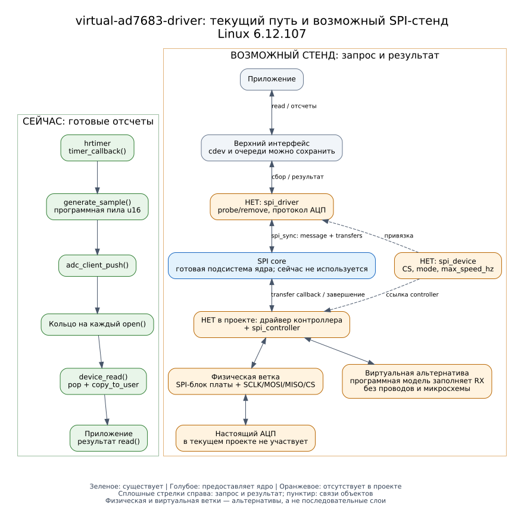

# SPI-слои и текущий virtual-ad7683-driver

Схема и пояснения относятся к Linux 6.12.107. **Факт:** текущий проект —
виртуальный АЦП с символьным интерфейсом; SPI-обмен в нем не реализован.
Правая часть схемы — возможная архитектура следующего стенда, а не готовый код.

## Схема

[Открыть схему в SVG](spi-layers.svg). SVG масштабируется без потери качества
и открывается браузером. Ниже та же логическая схема в Mermaid; текстовые
цепочки после нее доступны и без поддержки Mermaid.

```mermaid
flowchart TB
    subgraph CURRENT["Сейчас: путь готового отсчета"]
        T["hrtimer: timer_callback()"] --> G["generate_sample(): пила u16"]
        G --> PUSH["adc_client_push()"]
        PUSH --> R["Отдельное кольцо на каждый open()"]
        R --> READ["device_read(): pop + copy_to_user"]
        READ --> APP["Приложение получает результат read()"]
    end

    subgraph FUTURE["Возможный SPI-стенд: слои обмена"]
        USER["Приложение"] <-->|"read / отсчеты"| FRONT["Верхний интерфейс: cdev и очереди"]
        FRONT <-->|"сбор / готовые отсчеты"| PROTO["Нужно добавить: spi_driver, probe/remove, протокол"]
        PROTO <-->|"spi_sync: message + transfers / результат"| CORE["SPI core: готовая подсистема ядра"]
        CORE <-->|"transfer_one или transfer_one_message / завершение"| CTLR["Нужен для стенда: драйвер + spi_controller"]
        CTLR <-->|"физическая ветка"| HW["SPI-блок платы: SCLK, MOSI, MISO, CS"]
        HW <--> ADC["Настоящая микросхема АЦП"]
        CTLR <-->|"виртуальная альтернатива"| EMU["Программная модель: заполняет RX тестовыми байтами"]
        DEV["Нужно создать: spi_device — CS, mode, max_speed_hz"]
        DEV -.->|"привязка"| PROTO
        DEV -.->|"ссылка controller"| CTLR
    end

    classDef present fill:#e8f5e9,stroke:#2e7d32,color:#142b18;
    classDef missing fill:#fff3e0,stroke:#b86500,color:#392600;
    classDef kernel fill:#e3f2fd,stroke:#1565c0,color:#102b4b;
    class T,G,PUSH,R,READ,APP present;
    class PROTO,CTLR,HW,ADC,EMU,DEV missing;
    class CORE kernel;
```





Зеленое — существующий путь. Голубое — предоставляется ядром, но сейчас не
используется драйвером. Оранжевое — отсутствует в реализации проекта.
Верхний интерфейс правой схемы можно построить на существующих cdev и очередях,
но подключение к SPI еще потребуется реализовать. Сплошные двунаправленные
стрелки справа обозначают запрос и результат; пунктир — связи объектов.

Текстовая версия:

```text
Сейчас: hrtimer -> генератор -> push -> кольцо клиента -> read -> приложение

SPI:    верхний интерфейс <-> драйвер протокола <-> SPI core <-> драйвер контроллера
                                                              |
                          +-----------------------------------+----------------+
                          |                                                    |
                   SPI-блок платы -> провода -> АЦП                 программная модель RX
                          физическая ветка                           виртуальная ветка

spi_device описывает периферию, ссылается на контроллер и привязывается к spi_driver.
Физическая и виртуальная ветки — альтернативы для стенда.
```

## Как читать слои

1. **Приложение и верхний интерфейс.** Пользователю нужны отсчеты, поэтому
   он вызывает `read()` для `/dev/ad7683`. Символьное устройство — способ
   отдать данные приложению. SPI — способ получить их от микросхемы.
   Это разные задачи: наличие `/dev/ad7683` не означает наличие SPI.

2. **Драйвер протокола (`spi_driver`).** Знает правила конкретного АЦП:
   сколько бит читать, нужны ли команды, какие mode, CS и паузы допустимы,
   как превратить RX в значение отсчета. Он формирует `spi_message` из
   `spi_transfer`, вызывает, например, `spi_sync()`, проверяет результат
   и передает готовый отсчет верхнему уровню. `probe(struct spi_device *)`
   подготавливает периферию; `remove()` останавливает обращения и освобождает
   ресурсы. Существующий модуль выполняет верхние задачи АЦП, но еще не
   является драйвером, зарегистрированным на SPI-шине.

3. **SPI core.** Общая инфраструктура Linux: сопоставляет устройства и
   драйверы, проверяет запросы, обеспечивает порядок обмена и завершение.
   Ее не нужно писать заново. В 6.12.107 `spi_sync()` может начать выполнение
   сразу либо использовать очередь: отдельный поток не обязателен для каждого
   запроса. Контракт для вызывающего один — функция может спать и возвращает
   итоговый статус, а не число отсчетов.

4. **Драйвер контроллера и `spi_controller`.** Драйвер умеет выполнить
   передачу, а структура описывает его возможности и callbacks. На плате
   это управление регистрами SPI-блока, при необходимости IRQ/DMA. В
   виртуальном стенде это программное заполнение RX. Для аппаратной платы
   обычно используется существующий драйвер ее контроллера; писать свой
   необходимо только для выбранного программного стенда либо неподдержанного
   оборудования. Контроллер не должен знать о клиентских кольцах `/dev/ad7683`.

5. **Провода и микросхема.** Физический контроллер формирует SCLK и CS,
   передает MOSI и принимает MISO. У АЦП отдельно есть время преобразования:
   частота SCLK не равна частоте получения отсчетов. Программный контроллер
   позволяет изучить API и lifetime запросов, но не проверяет электрические
   сигналы и реальные временные требования AD7683.

`spi_device` — не дополнительная функция пересылки между слоями, а объект
конкретной периферии: «эта микросхема на этом контроллере и этом CS».
Поэтому на схеме он стоит сбоку. Обобщенная цепочка
`spi_controller -> spi_device -> spi_driver` описывает связи и привязку,
а не порядок вызовов при передаче данных.

## Откуда появятся объекты

1. Драйвер контроллера выделяет `spi_controller`, задает возможности и
   callbacks, вызывает `spi_register_controller()`.
2. SPI core создает `spi_device` по Device Tree, ACPI или таблице
   `spi_board_info`. Для отдельного программного стенда удобно явно вызвать
   `spi_new_device()` на зарегистрированном контроллере.
3. Регистрация `spi_driver` и появление подходящего устройства приводят к
   сопоставлению через `spi_match_device()`. Учитываются `driver_override`,
   OF, ACPI, затем `id_table`/имя. При совпадении обертка `spi_probe()` вызывает
   `probe()` драйвера протокола. Драйвер может зарегистрироваться и до устройства.

Вызов `device_create()` в текущем проекте создает объект класса для символьного
устройства. Он не заменяет `spi_new_device()`: обычный `struct device` внутри
`ad7683_device` не становится `struct spi_device` из-за названия АЦП.

## Что уже есть и чего нет

| Компонент | Сейчас | Где это видно / для чего нужен |
| --- | --- | --- |
| Символьное устройство и файловые операции | Есть | `src/device.c`: `ad7683_device_init()`, `ad7683_fops`, `device_read()` |
| Независимые клиентские очереди и пробуждение читателей | Есть | `src/client.c`: `adc_client_push()`, `adc_client_pop()`; клиент создается на `open()` |
| Источник отсчетов | Есть, программный | `src/device.c`: `timer_callback()` вызывает `generate_sample()` и раздает один результат клиентам |
| SPI core | Есть в выбранном ядре, не подключен к пути проекта | В `doc/config-6.12.107` включены `CONFIG_SPI` и `CONFIG_SPI_MASTER` |
| `spi_driver`, SPI `probe/remove` | Нет | Нужны для управления периферией по протоколу АЦП |
| Зарегистрированный `spi_device` проекта | Нет | Нужны описание CS, режима, частоты и привязка к драйверу |
| Драйвер контроллера / `spi_controller` стенда | Нет в проекте | Нужен исполнитель SPI-запросов; существующий контроллер ОС — отдельный вопрос |
| `spi_message`, `spi_transfer`, TX/RX и SPI-завершение | Нет | Сейчас отсчет получается вызовом C-функции, без транспортной операции |
| Физические линии и настоящий АЦП | Не участвуют | Проект не выполняет аппаратное измерение; состав оборудования вне проекта здесь не проверялся |

## Как связать это с уже знакомым кодом

**Факт:** `timer_callback()` сейчас делает `generate_sample()` и
`adc_client_push()`. `device_read()` вызывает `adc_client_pop()`; при пустом
кольце он ждет, а не отправляет запрос генератору. Поэтому вставка
`spi_sync()` прямо в `read()` изменила бы модель получения данных и потребовала
бы отдельно решать, как сохранить общие отсчеты для независимых клиентов.

**Предложение для отдельного минимального стенда:** сначала создать виртуальный
контроллер, один `spi_device` и маленький `spi_driver`. В `probe()` выполнить
один RX-запрос на два байта через `spi_sync()` и проверить статус,
`actual_length` и ожидаемое содержимое RX. Тестовые байты задаются протоколом
стенда; это еще не точная эмуляция настоящего AD7683. Так регистрация и один
обмен будут понятны до добавления таймера и многоклиентского интерфейса.

**Возможное последующее соединение с текущим проектом:** сохранить отдельные
очереди, а источник данных заменить на сбор через SPI. Таймер ставит работу,
worker выполняет запрос и проверяет ошибку, затем готовое значение раздается
через `adc_client_push()`. `spi_sync()` нельзя вызвать из текущего callback
таймера или под spinlock: он может спать. SPI-буферы должны жить до завершения;
при удалении нужно остановить таймер, работу и незавершенные операции, прежде
чем освобождать их память.

Это архитектурный вариант, не реализация: отдельно потребуется выбрать поведение
при занятом worker, ошибке обмена и пропуске периода. Повторная постановка одной
и той же работы может объединяться; она не гарантирует один запрос на каждый
тик. Существующие ABI, native-endian `u16` и семантика `read()` должны сохраниться.

## Что прочитано для схемы

Полный `drivers/spi/spi.c` не читался подряд. Использованы целевые фрагменты
локального дерева Linux 6.12.107:

- `Documentation/spi/spi-summary.rst`: типы драйверов, сообщения и регистрация контроллера.
- `include/linux/spi/spi.h`: `spi_driver`, callbacks контроллера, `spi_transfer`.
- `drivers/spi/spi.c`: `spi_match_device()`, вызов `sdrv->probe(spi)`
  и выбор немедленного выполнения или очереди в `__spi_sync()`.
- `src/device.c`, `src/client.c`, `inc/device.h`, `Kbuild` и сохраненная конфигурация ядра.

Официальные справочники: [SPI summary](https://www.kernel.org/doc/html/v6.12/spi/spi-summary.html)
и [SPI API](https://www.kernel.org/doc/html/v6.12/driver-api/spi.html).
